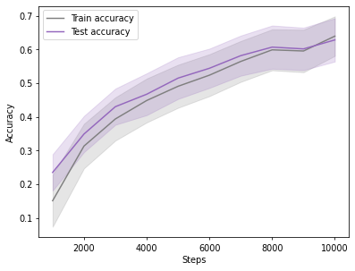
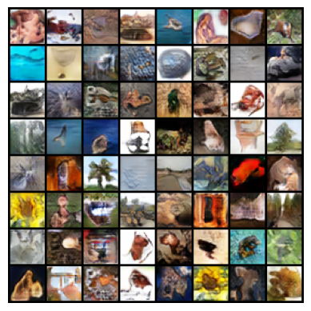
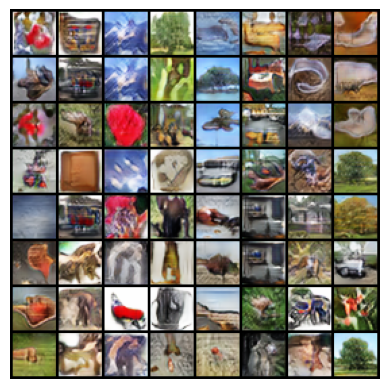

# Efficient CIFAR-100 Modelling

This project investigates how much performance can be extracted from two deep learning models under deliberately tight resource constraints. The first is a compact image classifier limited to 100k parameters and 10,000 optimisation steps, whilst the second is a class-conditional generative adversarial network (cGAN) limited to 1M parameters and 50,000 steps. Both were trained on CIFAR-100 and built incrementally. Each design decision started from a simple, stable baseline and was then retained only where it demonstrably improved results.

## Headline Results

| Model | Constraint | Final model | Result |
|---|---|---|---|
| MobileNet-inspired classifier | 100k parameters, 10k steps | 99,344 parameters | **62.9%** test accuracy |
| Projection-based cGAN | 1M parameters, 50k steps | 985,796 parameters | **FID of 38.0** against the CIFAR-100 test set |

## Repository Contents

| File | Description |
|---|---|
| `xtzv61-classifier.ipynb` | Classifier implementation, training loop and evaluation |
| `xtzv61-generative-model.ipynb` | cGAN implementation, training loop, FID and LPIPS evaluation |
| `DL_paper.pdf` | Short paper covering methodology, results and limitations |
| `assets/` | Figures used in this README |

## Part 1: Compact Classifier

The classifier is built on the MobileNet family, since factorising a standard convolution into a depthwise filter and a 1×1 pointwise projection reduces the cost of a 3×3 layer from 9·C<sub>in</sub>·C<sub>out</sub> to 9·C<sub>in</sub> + C<sub>in</sub>·C<sub>out</sub> parameters. I implemented the lineage incrementally, with each stage compared against the one before it.

- **MobileNetV1 baseline.** Depthwise-separable blocks with a width multiplier α to fit the parameter budget, which comfortably cleared 40% test accuracy.
- **MobileNetV2 elements.** Inverted residuals with linear bottlenecks and ReLU6, raising accuracy above 55%.
- **MobileNetV3-inspired elements.** Efficient Channel Attention (ECA) in mid-to-late blocks as a low-cost alternative to squeeze-and-excite, together with per-block expansion factors and selective 5×5 depthwise kernels.
- **Optimisation.** SGD with momentum and cosine annealing, followed by a reduced learning rate for the final 2,000 steps to tighten the train-test gap.



The final model reaches 64.0% training accuracy and 62.9% test accuracy. The train-test gap of roughly 1% suggests stable generalisation without overfitting.

## Part 2: Conditional Generative Model

The generator follows a DCGAN-style design that was extended one component at a time and evaluated through ablations.

- **Hinge loss and spectral normalisation** to preserve useful gradients and bound the discriminator's Lipschitz constant.
- **Residual blocks** in both networks, with batch normalisation removed from the upsampling blocks after it was found to reduce sharpness.
- **Projection-based class conditioning** in the discriminator, which injects label information directly into its decision function.
- **TTUR-inspired update schedule** that updates the discriminator twice per generator step.
- **Exponential moving average (EMA)** of generator weights with a warmup period, used for all sampling and evaluation.

Mild latent truncation was also trialled but removed, as the gain in diversity came at the cost of realism and FID.

| Random samples (not cherry-picked) | Linear latent interpolations |
|---|---|
|  |  |

The final model achieves an FID of 38.0. As a rough memorisation check, the mean LPIPS distance between a 64-sample batch and its nearest neighbours in 10,000 training images was 0.0985.

## Key Learnings

- **Capacity is the binding constraint at small scales.** Increasing α beyond 0.8 breached the parameter budget, and mixup and CutMix consistently reduced accuracy by around 5%, which may be attributable to the network lacking capacity to exploit harder augmented distributions.
- **Optimiser choice matters as much as architecture.** Replacing Adam with SGD and momentum improved test accuracy by roughly 3% and interacted more effectively with cosine annealing.
- **Published techniques do not transfer automatically.** MobileNetV3 assumes 224×224 inputs and exceeds 2M parameters, so it had to be adapted selectively, whilst style mixing and path length regularisation were ineffective at 32×32 resolution.
- **Stability should precede sophistication in GANs.** Hinge loss, spectral normalisation, TTUR and EMA reduced variance, although the final model remained sensitive to initialisation and hyperparameters.
- **Isolated changes make results interpretable.** Introducing one modification at a time made it possible to attribute gains and discard components that did not help.

## Limitations

Image quality was judged partly by eye, which introduces human bias into architectural decisions, and a more exhaustive analysis of sample uniqueness would strengthen the evaluation. Resolution and the optimisation budget also place a hard ceiling on the fine-grained detail either model can learn.

## Running the Notebooks

Both notebooks were developed on a GPU. The main dependencies can be installed with the following command.

```bash
pip install torch torchvision matplotlib numpy pandas optuna clean-fid lpips
```

The classifier is seeded (405) for reproducibility. The generative notebook shows small run-to-run variation in the generated images, although the FID remained within roughly ±0.05 across runs.

## References

Full references are listed in `DL_paper.pdf`. The architectures draw primarily on MobileNetV1 to V3 (Howard et al. and Sandler et al.), DCGAN (Radford et al.), spectral normalisation and projection discriminators (Miyato et al.) and TTUR (Heusel et al.).
